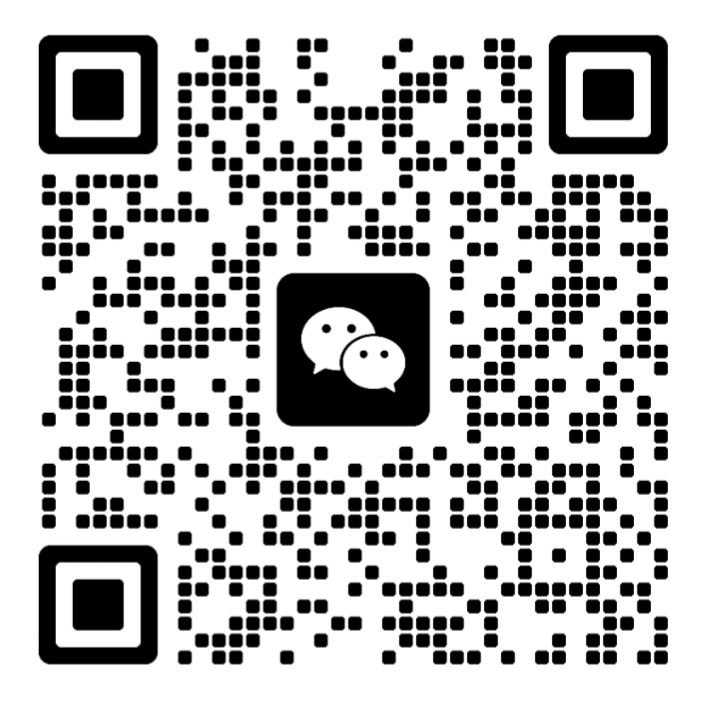
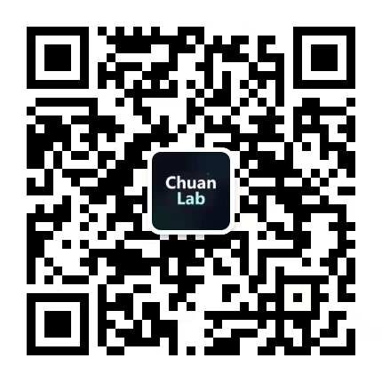

<p align="center">
  <picture>
    <source media="(prefers-color-scheme: dark)" srcset="assets/readme/logo-dark.svg">
    
  </picture>
</p>

<p align="center">
  <strong>English</strong> · <a href="README.zh-CN.md">简体中文</a>
</p>

<p align="center">
  <a href="https://github.com/Light0305/Light-WeChat/releases/tag/v1.0.0"></a>
  <a href="LICENSE"></a>
  
  
</p>

**From a good question to a WeChat article ready for review.**

Light-WeChat is a Skill for AI agents that helps research, write, edit, illustrate and format articles for WeChat Official Accounts. It keeps sources and claims traceable, checks the actual mobile layout, and can upload a verified draft to **your own account** when you ask.

Built around AI, papers, computing careers and projects with real supporting material. Your publication name, author, columns and contact card are configurable. The workflow runs locally by default; account connections and paid image services are optional.

[Website](https://lightchuan.space/) · [Install](#installation) · [Custom image models](#custom-image-models) · [Support & feedback](#support--feedback)

## Installation

Use Codex or an agent that can read `SKILL.md`, run local commands and inspect browser screenshots. You need **Python 3.11+**, **Node.js 22.20+**, and a local **Chrome, Edge or Chromium** browser. Search and built-in image generation are provided by your agent; this project does not include model subscriptions or API credits.

### Ask your agent

```text
Install the Light-WeChat skill from https://github.com/Light0305/Light-WeChat
into this project's skills directory. Keep the complete directory, install its
locked Python dependencies in a dedicated virtual environment, and run doctor.py.
Use local preview by default; I will configure my own integrations if needed.
```

### Install with the skills CLI

Prefer a complete source bundle? Download it from [Releases](https://github.com/Light0305/Light-WeChat/releases/latest), then follow the manual installation and dependency setup below.

Windows:

```powershell
npx.cmd skills@latest add Light0305/Light-WeChat --skill light-wechat
```

macOS / Linux:

```bash
npx skills@latest add Light0305/Light-WeChat --skill light-wechat
```

The [skills CLI](https://github.com/vercel-labs/skills) also requires Git. Choose your agent and installation scope in its prompts. For a project installation, run it from the target project. Installing the Skill does **not** install its Python dependencies.

For manual installation, put the **entire** source directory at `.agents/skills/light-wechat/` in your project, or in your agent's equivalent skill location. `SKILL.md` must sit directly in that directory alongside `scripts/`, `shared/`, `tools/` and `vendor/`. Copying only `SKILL.md` is insufficient.

### Set up the local environment

Open a terminal in the installed Skill directory.

Windows PowerShell:

```powershell
python -m venv .venv
./.venv/Scripts/python -m pip install --require-hashes -r requirements.txt
./.venv/Scripts/python scripts/configure.py init
./.venv/Scripts/python scripts/doctor.py
```

macOS / Linux:

```bash
python3 -m venv .venv
.venv/bin/python -m pip install --require-hashes -r requirements.txt
.venv/bin/python scripts/configure.py init
.venv/bin/python scripts/doctor.py
```

For subsequent `python` commands, use this virtual environment's interpreter or activate it first. Local execution was tested on Windows; macOS/Linux discovery is implemented but has not been verified on those systems. See [verification notes](RELEASE_AUDIT.md).

## In use

[](https://lightchuan.space/)

[Chuan Lab · lightchuan.space](https://lightchuan.space/) — the author's publication, covering AI, papers, computing careers and personal projects. This is a real homepage screenshot supplied for the README. The website is a separate showcase; website hosting and synchronization are not included in Light-WeChat.

## Start with a question

Ask your agent to use the installed Skill:

```text
Use $light-wechat to suggest one strong article idea each for AI, papers and
computing careers. Explain the reader benefit and recommend a first choice.
After I pick one, complete the article, illustrations and mobile preview locally.
```

Already have a topic?

```text
Use $light-wechat to explain this paper for developers: <paper URL or local PDF>.
Follow the original evidence, explain the mechanism and limitations, and make
a WeChat-ready article with a cover and a checked mobile layout. Keep it local.
```

You can also ask for a single stage: reviewing a draft, improving its structure, replacing a cover, or formatting existing Markdown. An illustration or formatting request only runs that stage.

### What it does

| Stage | What you get |
| --- | --- |
| Research | Topic candidates, original sources, an editorial brief and a clear reader promise |
| Writing | Explanations built around mechanisms, examples, evidence and limitations |
| Review | Fact checks, editorial revisions and a record of what was reviewed |
| Visuals | A cover master with wide and square crops; illustrations chosen for their information value |
| Layout | WeChat-compatible HTML and actual 375 / 390 px browser previews |
| Optional delivery | A version-bound draft upload to your configured account, followed by API readback |

Each article has its own folder under `workspace/articles/`, with its draft, evidence, images, reviews, preview and delivery records kept together. Rendered HTML and passing scripts help with checks; the agent still needs to read the sources and inspect the actual images and layout.

### Make it yours

`configure.py init` creates local templates without overwriting existing settings. Edit `chuanlab.toml`:

```toml
[publication]
name = "Your publication"
author = "Your name"
columns = ["ai", "papers", "careers", "projects"]
contact_card = ""
```

The compatibility filename `chuanlab.toml` is intentional. The public Skill entry is `light-wechat`, so it can coexist with a separate `chuan-lab` installation.

- `paths.workspace` sets the article workspace; the default is `workspace/`.
- `publication.contact_card` optionally points to your own image. It is blank by default; the author's README QR codes are never inserted into your articles.
- `preview.browser` can point to your preferred browser executable.
- Relative paths are resolved from the Skill directory. Advanced users can explicitly set `CHUANLAB_CONFIG` or `CHUANLAB_WORKSPACE`.

## Custom image models

Light-WeChat prefers your agent's **built-in image generation**. If that tool is unavailable or fails technically, you can enable your own **HTTPS Images-compatible API** as a fallback, or explicitly choose your configured service for a task. No provider, model or key is bundled.

Save the key through a hidden local terminal prompt:

```bash
python scripts/configure.py images
```

Then edit `chuanlab.toml`:

```toml
[images]
enabled = true
base_url = "https://your-provider.example/v1"
model = "your-model-name"
```

Use the service's **base URL**, not its full `/images/generations` endpoint. The adapter appends `/images/generations` or `/images/edits`; a root URL without a path gets `/v1` added. Model names, sizes and edit support depend on the provider.

The key stays in the ignored local `.env` as `IMAGE_API_KEY`. It is not read from other projects or global image configurations. `--dry-run` makes no network or paid request and does not read the key. A real request requires the enabled configuration and explicit `--confirm-paid` authorization. An uncertain result is recorded before any retry; saved successful responses can be recovered without paying for another generation.

See [image API configuration and examples](references/image-provider.md). Safety refusals are not routed to another provider.

## Connect your WeChat account

Local writing and previews need no WeChat credentials. To enable draft upload, use an account with the required API permissions and configure its IP allowlist in WeChat's administration interface.

```bash
python scripts/configure.py wechat
```

The local prompt collects your AppID and hides your AppSecret. Then set `[wechat] enabled = true` in `chuanlab.toml`. Keys remain in the local `.env`; never paste them into a chat, screenshot or Issue.

For the article you want to upload, set `delivery` to `wechat-draft`, complete its checks and freeze, then explicitly request upload of that version. The workflow requires `--confirm-upload`, binds the account to the frozen version, and reads the result back. Revisions update the existing draft where possible; ambiguous results must be reconciled before retrying.

An uploaded draft is **pending your review in WeChat**. Freezing is a quality checkpoint, not upload consent. The project has no mass-send or formal-publication command. See [delivery commands](references/delivery.md).

## Included resources

The full directory includes the publisher backend, workflow scripts and pinned source resources. It does not depend on another user's installation.

| Resource | Details |
| --- | --- |
| [Skill entry](SKILL.md) | Task routing and the complete editorial workflow |
| [File contract](references/artifact-contract.md) | Article files, evidence and review records |
| [Upstream integration](references/upstream-study.md) | AIHOT, WeWrite, Baoyu, Humanizer, gzh-design and Guizang |
| [Source manifest](vendor/manifest.json) | 202 original files from six pinned upstreams, with hashes |
| [Third-party notices](THIRD_PARTY_NOTICES.md) | Licenses, adaptations and dependency attribution |
| [Security](SECURITY.md) | Local credential handling, secret scanning and release boundaries |

<details>
<summary>Development and release checks</summary>

```bash
python -m pip install --require-hashes -r requirements-dev.txt
python -m pytest
python scripts/verify_upstream.py
python scripts/install_gitleaks.py
python scripts/release_check.py
python scripts/build_release.py
```

Set `RUN_BROWSER_QA=1` to include the optional real-browser test. Dependencies are locked with hashes. Release checks run local secret rules and Gitleaks against the allowed source files and independent Git history, if present. Source code is not uploaded to a scanning service. The archive excludes credentials, article workspaces, installed dependencies and Git metadata, and includes a per-file SHA-256 inventory.

The optional Guizang HTML cover validator uses `npm ci --ignore-scripts` and a Playwright browser. Ordinary article previews use Node and your local browser directly. See [verification notes](RELEASE_AUDIT.md) for the checks actually run and their limits.

</details>

## Support & feedback

- Visit [lightchuan.space](https://lightchuan.space/) for articles and projects.
- Questions, bugs and suggestions: [GitHub Issues](https://github.com/Light0305/Light-WeChat/issues). PRs and concrete examples are welcome. Remove keys and private article content from reports.
- Email: [1833058953@qq.com](mailto:1833058953@qq.com) · GitHub: [@Light0305](https://github.com/Light0305).

<table align="center">
  <tr>
    <th align="center">Support the author</th>
    <th align="center">Chat on WeChat</th>
    <th align="center">Official account</th>
  </tr>
  <tr>
    <td align="center" width="33%"></td>
    <td align="center" width="33%"></td>
    <td align="center" width="33%"></td>
  </tr>
</table>

<p align="center">Optional support, a conversation, or a follow — thank you for trying Light-WeChat.</p>

## License

Project-authored code, documentation and adaptations are licensed under **[AGPL-3.0-only](LICENSE)**. Included third-party originals retain their own licenses; MIT originals remain MIT. See [NOTICE](NOTICE), [THIRD_PARTY_NOTICES.md](THIRD_PARTY_NOTICES.md) and the original license files under `vendor/`.

The website screenshot and contact/payment QR codes are authorized README display assets, not reusable article content or a license to use the author's identity. Asset provenance and usage boundaries are recorded in [README assets](assets/readme/README.md). Your articles and externally acquired images need their own rights assessment. Light-WeChat is an independent project and is not affiliated with or endorsed by WeChat or Tencent.
